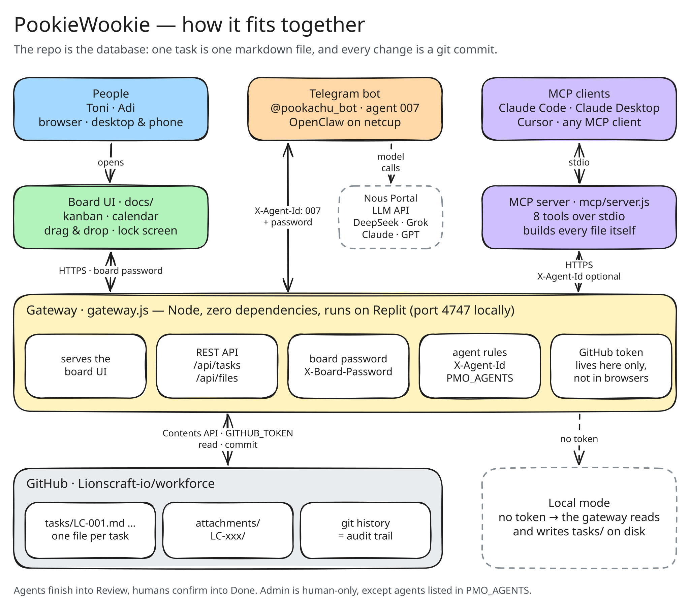

# PookieWookie

A kanban board that people and AI agents share, with no database: every task is a markdown file in a
GitHub repo, and every change is a git commit. The board UI, the calendar and the agents all work on
the same files.



How the pieces fit, the data model, consistency and security: [documentation/ARCHITECTURE.md](documentation/ARCHITECTURE.md).

## Quick start

```bash
npm start
```

Open **http://localhost:4747**. With no `GITHUB_TOKEN` set, the board reads and writes the `tasks/`
folder on disk, so you can try everything without touching GitHub. Node 20.12 or newer, no
`npm install` needed for the board itself.

To work against the repo instead, put a token in `.env` (`cp .env.example .env`). It needs
**Contents: Read and write** on the repo and nothing else.

## What it does

- **Board** — Backlog → Weekly → Focus → Review → Done, plus a human-only Admin column. Drag cards
  between and within columns; one drag is one commit.
- **Tasks** — assignee, due and start dates, labels, priority flag, subtasks and related tasks,
  attachments by drag & drop, a markdown brief with dated notes underneath.
- **Calendar** — every date any task carries: deadlines, multi-day spans, and extra events listed on a
  task.
- **Filters** — by person, label, priority, or free text. Archive finished work without deleting it.
- **Phone** — one column per screen; press and hold a card to drag it.
- **Lock** — optional single password for the whole board, entered once per browser.
- **Agents** — anything that can make an HTTP call can work the board, under rules the gateway enforces.

## Configuration

Environment variables only — `.env` locally, Secrets on Replit.

| Variable | Default | |
| --- | --- | --- |
| `PORT` | `4747` (`3000` on Replit) | where the gateway listens |
| `GITHUB_TOKEN` | — | fine-grained token, this repo only, Contents read and write. Without it: local mode or read-only |
| `BOARD_PASSWORD` | — | one password for reading and writing through the gateway |
| `PMO_AGENTS` | — | agent ids allowed to manage any task, e.g. `007` |
| `REPO_OWNER` / `REPO_NAME` / `REPO_BRANCH` | `Lionscraft-io` / `workforce` / `main` | which repo holds the tasks |
| `TASKS_DIR` | `tasks` | folder inside the repo |
| `BOARD_SOURCE` | automatic | `local` or `github` to force one |
| `MAX_UPLOAD_BYTES` | `5000000` | attachment size limit |

## Deploying on Replit

1. **Create Repl → Import from GitHub** → this repository. `.replit` is already configured.
2. **Secrets**: `GITHUB_TOKEN`, and `BOARD_PASSWORD` unless the URL stays private. Add `PMO_AGENTS`
   if an agent should run the whole board.
3. **Run**, then **Deploy → Reserved VM**.

The Repl pulls from GitHub every time it starts, so a restart is all an update needs. If the token
belongs to an organisation, it must be created under that organisation with a lifetime of at most 366
days, or GitHub refuses it.

## Connecting agents

| Agent runs in | Use | Docs |
| --- | --- | --- |
| Claude Code, Claude Desktop, Cursor, any MCP client | the MCP server in `mcp/` — eight native tools | [mcp/README.md](mcp/README.md) |
| a bot, script or workflow that makes HTTP calls | the gateway API with `X-Agent-Id` | [BOT.md](BOT.md) |

Agents finish work into **Review**; a person moves it to **Done**.

## Documentation

| | |
| --- | --- |
| [documentation/ARCHITECTURE.md](documentation/ARCHITECTURE.md) | components, data model, API, consistency, security, limitations |
| [BOT.md](BOT.md) | the full brief for an agent working the board over HTTP |
| [AGENTS.md](AGENTS.md) | short orientation for coding agents opening this repo |
| [mcp/README.md](mcp/README.md) | MCP server setup and tools |
| [tasks/README.md](tasks/README.md) | the task file format |

## Tests

```bash
cd mcp && npm install && npm test
```
